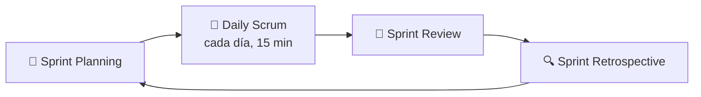

# 📋 Scrum

> [!tip] **Fuente oficial**
> Este resumen sigue el **Scrum Guide 2020** (Ken Schwaber y Jeff Sutherland), la definición oficial de Scrum.
> Disponible en [scrumguides.org](https://scrumguides.org/scrum-guide.html).

---

## 🎯 ¿Qué es Scrum?

**Scrum** es un marco de trabajo (*framework*) ágil y ligero diseñado principalmente para la gestión y desarrollo de software, aunque desde el Scrum Guide 2020 se usa también en otros tipos de trabajo complejo.

A diferencia de los modelos tradicionales en cascada (que planifican todo de forma rígida antes de empezar), Scrum abraza el cambio y busca reaccionar de forma flexible ante nuevos requerimientos sin sacrificar la estabilidad del proyecto. Se basa en un enfoque **iterativo e incremental**, entregando versiones operativas del sistema en ciclos cortos.

Scrum se fundamenta en el **empirismo** (las decisiones se toman según lo que se observa) y el pensamiento *lean* (eliminar desperdicios). Sus tres pilares son:

* **Transparencia:** el proceso y el trabajo son visibles para quienes los hacen y para quienes los reciben.
* **Inspección:** el trabajo se revisa con frecuencia para detectar desviaciones.
* **Adaptación:** en cuanto se detecta un problema, el proceso o el producto se ajustan de inmediato.

---

## 👥 El Scrum Team (Roles)

En Scrum no existe la figura del "jefe de proyecto" convencional que asigna órdenes de forma vertical. El equipo de trabajo (**Scrum Team**) es un equipo **pequeño, multifuncional y auto-gestionado** (típicamente 10 personas o menos) y se organiza en tres roles clave:

* **Product Owner (PO)**:
  * **Función**: Es el puente de comunicación entre el equipo técnico y los tomadores de decisiones o clientes internos. Es **una sola persona, no un comité**.
  * **Responsabilidades**: Maxima el valor del producto. Releva las necesidades de negocio, las traduce a requerimientos, filtra las peticiones y **ordena (prioriza) el Product Backlog** para asegurar que el equipo siempre construya lo de mayor valor. Comunica el **Product Goal** (objetivo a largo plazo del producto).
* **Scrum Master (SM)**:
  * **Función**: Es un experto en Scrum que actúa como *líder servidor* (*servant leader*): sirve al equipo.
  * **Responsabilidades**: Asegura que el equipo entienda y practique Scrum, causa la **remoción de impedimentos** en el día a día, asegura que los eventos de Scrum se lleven a cabo y se respeten sus tiempos, y protege al equipo de presiones externas. También sirve al Product Owner y a la organización en la adopción de Scrum.
* **Developers (Equipo de Desarrollo)**:
  * **Función**: Profesionales técnicos encargados de construir cualquier aspecto del incremento utilizable cada Sprint (programadores frontend, backend, móvil, analistas, testers/QA, DBAs, DevOps, etc.).
  * **Responsabilidades**: Son un equipo **multifuncional** (tienen todas las habilidades necesarias para crear valor) y **auto-gestionado** (*self-managing*): internamente deciden quién hace qué, cuándo y cómo. Los propios desarrolladores estiman el tamaño de las tareas, crean el **Sprint Backlog**, cuidan la calidad mediante la **Definition of Done** y se hacen mutuamente responsables como profesionales.

> [!note] **`Developers`, no `Development Team`**
> En el Scrum Guide 2017 el rol se llamaba **Development Team**. Desde la versión **2020** el término oficial es **Developers**, y el Scrum Team completo es **auto-gestionado** (*self-managing*), no solo "autoorganizado". Si en una entrevista o libro viejo lees *Development Team*, es el mismo rol con el nombre anterior.

**Otros actores del entorno:**

* **Customers / Clientes internos**: Áreas o tomadores de decisiones de la empresa que solicitan funcionalidades.
* **Usuarios finales (*Users*)**: Quienes utilizarán la aplicación y prueban que la solución realmente sirva.
* **Stakeholders**: Socios, patrocinadores o partes interesadas que aportan financiación e interés estratégico, y que participan en la Sprint Review.

---

## 🧩 Conceptos Clave

* **Sprint**: Período de tiempo **fijo y de un mes o menos** (en la práctica, usualmente de 1 a 2 semanas) en el que se desarrolla y entrega un incremento de software utilizable. Un nuevo Sprint arranca inmediatamente después de terminar el anterior. Dentro de un Sprint **no se ponen en riesgo la calidad ni el Sprint Goal**, aunque el alcance puede renegociarse con el Product Owner.
* **Sprint Goal**: El objetivo único del Sprint, definido en el Sprint Planning. Da coherencia y foco al equipo.
* **Product Backlog**: Lista **emergente y ordenada** (cambiante) que reúne todas las funcionalidades, requisitos, mejoras y correcciones pendientes del producto. Es la **única fuente de trabajo** del equipo.
* **Sprint Backlog**: El Sprint Goal + los elementos del Product Backlog seleccionados para el Sprint + el plan para entregarlos. Es un plan creado **por y para** los Developers.
* **Historias de Usuario (*User Stories*)**: Forma común (no definida en el Scrum Guide) de redactar una funcionalidad desde la perspectiva del usuario final. Ejemplo: *"Yo como usuario quiero pagar con tarjeta para completar mi compra"*. A partir de la historia, los desarrolladores desglosan las tareas técnicas.
* **Incremento**: Versión operativa, funcional y verificada del software que se entrega terminada al cierre de un Sprint. Cada incremento se suma a todos los anteriores y debe ser **usable**.
* **Definition of Done (DoD)**: Descripción formal del estado del incremento cuando cumple los estándares de calidad del producto. Un trabajo que no cumple la DoD no forma parte del incremento.

---

## 🗓️ Eventos de Scrum

El **Sprint es el evento contenedor**: dentro de él ocurren los 4 eventos fundamentales. Cada evento es una oportunidad formal de inspección y adaptación.

1. **Sprint Planning (Planificación del Sprint)**:
   * **Cuándo**: El primer día del Sprint. *Timebox*: máximo 8 horas para un Sprint de un mes (menos para Sprints más cortos).
   * **Objetivo**: El Product Owner presenta los elementos de mayor prioridad del *Backlog* y por qué son valiosos; los Developers seleccionan lo que pueden completar, estiman el esfuerzo y **entre todos definen el Sprint Goal**; después planifican cómo harán cada elemento.
2. **Daily Scrum (Reunión Diaria)**:
   * **Cuándo**: Todos los días del Sprint, a la misma hora y lugar, **máximo 15 minutos**.
   * **Objetivo**: Que los Developers inspeccionen su avance hacia el Sprint Goal y ajusten el plan del día siguiente. Identifica impedimentos rápidamente.

   > [!info] **Las 3 preguntas clásicas**
   > *"¿Qué hice ayer?, ¿qué haré hoy?, ¿tengo algún impedimento?"* es la **práctica más común**, pero el Scrum Guide 2020 **no la prescribe**: deja al equipo libre de elegir la estructura, siempre que la reunión enfoque el avance hacia el Sprint Goal y termine con un plan accionable para el día.

3. **Sprint Review (Revisión del Sprint)**:
   * **Cuándo**: Al finalizar el Sprint, antes de la Retrospective. *Timebox*: máximo 4 horas para un Sprint de un mes.
   * **Objetivo**: El equipo **demuestra el incremento** construido a stakeholders, clientes y usuarios para recibir retroalimentación (*feedback*), inspeccionar resultados y decidir qué sigue. El Product Backlog puede ajustarse con las nuevas oportunidades. No debe ser solo una presentación: es una sesión de trabajo colaborativo.
4. **Sprint Retrospective (Retrospectiva del Sprint)**:
   * **Cuándo**: Al terminar el Sprint (después de la Review; cierra el Sprint). *Timebox*: máximo 3 horas para un Sprint de un mes.
   * **Objetivo**: Reunión del equipo para **planificar cómo aumentar la calidad y la efectividad**: qué se hizo bien, qué salió mal, cómo se resolvieron (o no) los problemas, y qué cambios aplicar ya. Las mejoras más importantes pueden entrar al Sprint Backlog del siguiente Sprint.

---

## 🛠️ Herramientas y su Uso en el Día a Día

Scrum no define herramientas, pero en la práctica se usan estas:

* **Gestión de Tareas y Tableros**: **Jira**, **Azure DevOps**, **Trello** o **Notion** para gestionar el *Backlog* mediante tarjetas/tickets y visualizar el avance del Sprint en columnas (*To Do / Pendiente*, *In Progress / En Progreso*, *Done / Finalizado*).
* **Comunicación y Sincronía**: **Slack** o **Microsoft Teams** para mantener al equipo conectado, reportar impedimentos y llevar a cabo las *dailys* (incluso de forma escrita en equipos remotos).

---

> [!quote] **Referencia**
> Basado en la investigación del 2026-10-21 (2 videos + apoyo de Gemini) y contrastado con el *Scrum Guide 2020*.
